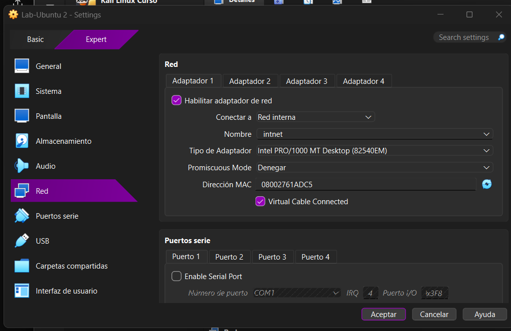
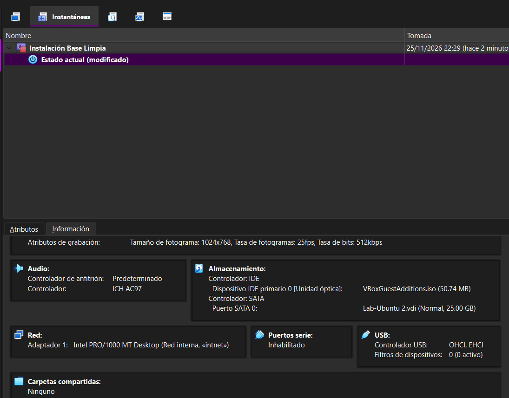

# Mi laboratorio seguro: Virtualización con VirtualBox

## Objetivo

Crear un entorno virtual aislado para realizar prácticas
de ciberseguridad de forma controlada.

## Configuración de la máquina virtual

- Hipervisor: Oracle VirtualBox 7.2.22.
- Máquina virtual: Lab-Ubuntu 2.
- Sistema operativo: Ubuntu 24.04 LTS.
- Memoria RAM: 4096 MB.
- Procesadores: 2.
- Disco virtual: 25 GB.
- Guest Additions: instaladas.
- Modo de red: Red Interna (intnet).

## Justificación técnica

Elegí el modo Red Interna porque permite aislar la máquina
virtual de Internet, del equipo anfitrión (Host) y de la
red doméstica. Solamente permite la comunicación entre
máquinas virtuales conectadas a la misma red interna.

No utilicé el modo Adaptador Puente (Bridged) porque
conecta directamente la máquina virtual con la red física,
lo que podría exponer otros dispositivos a posibles amenazas.

## Evidencia de configuración de red

## Instantánea de seguridad

Creé una instantánea llamada "Instalación Base Limpia"
para poder restaurar el sistema operativo a su estado
inicial en caso de errores durante futuras prácticas.

## Dificultades y soluciones

Durante la instalación experimenté problemas de rendimiento,
compatibilidad gráfica y dependencias de las Guest Additions.

Utilicé Ubuntu 24.04 LTS y aumenté la memoria RAM de
2 GB a 4 GB para facilitar la instalación. También instalé
los paquetes necesarios para las Guest Additions.

## Conclusión

Aprendí a configurar una máquina virtual, instalar un
sistema operativo, aislar la conexión de red y crear
instantáneas de seguridad.

Estos conocimientos son fundamentales para realizar
prácticas de ciberseguridad en un entorno controlado.
